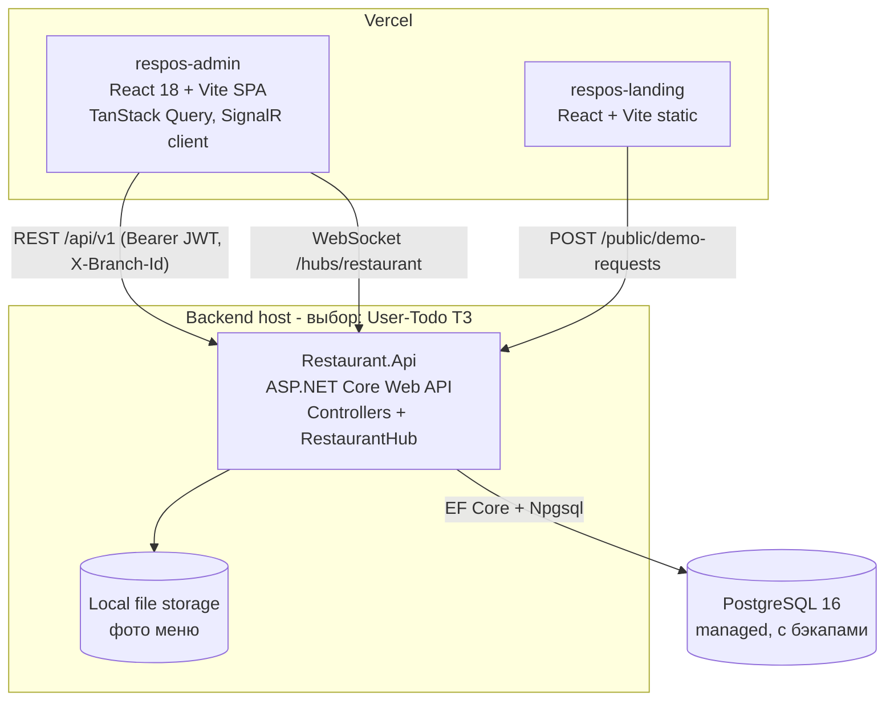
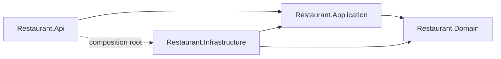
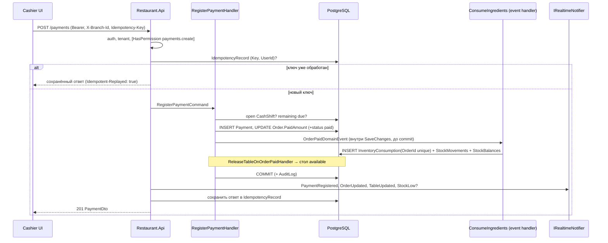

# RestaurantOS — обзор архитектуры

Связанные документы: контракт `respos-contracts/` (источник истины для API; v1.2 — `ENDPOINTS.md` по реальным DTO),
ADR в `docs/architecture/ADR/`, модель данных `docs/database/ERD.md`, бизнес-правила `docs/requirements/BUSINESS_RULES.md`,
практическое руководство backend — `respos-backend/README.md`. Документ отражает реализованный MVP (2026-11-10).

## 1. Кратко

- **Модульный монолит** на .NET 8 (план перехода на .NET 10 LTS — ADR-0009), Clean Architecture (ADR-0001).
- Одна БД PostgreSQL, общая схема, tenant scoping через `OrganizationId` + `BranchId` (ADR-0002).
- Один React SPA `respos-admin` с рабочими пространствами (Admin, Waiter, KDS, Cashier, Stock, Platform) и отдельный статический `respos-landing` (ADR-0010).
- REST `/api/v1` — источник данных; SignalR `/hubs/restaurant` — только уведомления (ADR-0005).
- Auth: короткий JWT в памяти + ротируемый refresh token в httpOnly cookie (ADR-0003).

## 2. Контекст (C4 — уровень 1)

Пунктир — интеграции, которых в MVP нет (в UI помечаются «Демо» / «Не подключено»).

## 3. Контейнеры (C4 — уровень 2)

## 4. Слои backend

Решение: `respos-backend/` (в ТЗ — `backend/`).

| Проект | Содержит | Зависит от |
|---|---|---|
| `src/Restaurant.Domain` | Entities, Value Objects, Enums, доменные события, исключения, `Constants/Permissions.cs`, базовые `Entity`/`AuditableEntity`/`ITenantScoped`/`IBranchScoped`/`IArchivable`, `Result`/`Error` | ничего |
| `src/Restaurant.Application` | Use cases `Features/<Module>/<UseCase>/` (command/query record + `AbstractValidator` + `IHandler<TRequest,TResponse>`), DTO, доменные event handlers; абстракции: `IApplicationDbContext`, `ITenantContext`, `IClock`, `IFileStorage`, `IPaymentProvider`, `IRealtimeNotifier`, `IEmailSender`, `IAuditLogger`, `IIdempotencyService`, `INotificationPublisher`, `IDomainEventHandler<T>` | Domain |
| `src/Restaurant.Infrastructure` | `AppDbContext` (partials по модулям), configurations, migrations, seeders, identity (хеширование, JWT, refresh tokens), `AuditableEntityInterceptor`, `DomainEventDispatcher`, SignalR notifier, `ManualPaymentProvider`, `LogEmailSender` (заглушка), локальное файловое хранилище, idempotency store | Application, Domain |
| `src/Restaurant.Api` | Controllers, middleware, filters, `[HasPermission]` (policy provider), `RestaurantHub`, rate limiting, DI composition, Swagger, health checks | Application, Infrastructure (только composition root) |
| `tests/Restaurant.UnitTests` | Domain + Application unit tests | |
| `tests/Restaurant.IntegrationTests` | API + Postgres (Testcontainers) | |

Правила: `Api → Application → Domain`; Infrastructure реализует абстракции Application. Domain не ссылается
на ASP.NET Core, EF Core, SignalR. В контроллерах нет DbContext и бизнес-логики — только маппинг HTTP ↔ command/query.

## 5. Модули

Фактические папки `Restaurant.Application/Features/*` (сущности — `Domain/Entities/<Module>/`, конфигурации — `Infrastructure/Persistence/Configurations/<Module>/`).

| Модуль | Features-папки | Ключевые сущности | Права (префикс) |
|---|---|---|---|
| Identity | `Auth` (Login, Refresh, Session, Passwords, AcceptInvitation), `Users`, `Roles` | User, Role, Permission, RefreshToken, UserInvitation, PasswordResetToken | `users.*`, `roles.*` |
| Organization / SaaS | `Organizations`, `Platform` (Organizations, Plans, FeatureFlags, DemoRequests, SystemInfo), `Public` | Organization, Plan, Subscription, FeatureFlag, DemoRequest | `settings.*`, `platform.*` |
| Branches | `Branches` | RestaurantBranch, BranchSettings, UserBranchAccess | `branches.*` |
| Floor | `Floor` (DiningAreas, Tables) | DiningArea, DiningTable | `tables.*` |
| Reservations | `Reservations` | TableReservation | `reservations.*` |
| Menu | `Menu` (Categories, Items, ModifierGroups, Pos), `KitchenStations` | MenuCategory, MenuItem, MenuItemVariant, ModifierGroup/Option, MenuAvailability, KitchenStation | `menu.*` |
| Orders | `Orders` | Order, OrderItem, OrderItemModifier, OrderStatusHistory | `orders.*` |
| Kitchen | `Kitchen` (ListTickets, UpdateTicketStatus) | KitchenTicket, KitchenTicketItem | `kitchen.*` |
| Inventory | `Inventory` (Units, IngredientCategories, Ingredients, StockMovements, InventoryCounts, Consumption), `Recipes` | UnitOfMeasure, Ingredient, StockBalance, StockMovement, Recipe, InventoryConsumption, InventoryCount | `inventory.*`, `recipes.*` |
| Procurement | `Procurement` (Suppliers, Purchases) | Supplier, PurchaseOrder, PurchaseOrderItem | `suppliers.*`, `purchases.*` |
| Payments | `Payments` (RegisterPayment, RefundPayment, ListPayments, CashShifts) | Payment, Refund, CashShift | `payments.*`, `cash-shifts.*` |
| Reporting | `Reports` (Sales, CashShifts, Export CSV), `Dashboard` | read-запросы | `reports.read` |
| Notifications | `Notifications` (Inbox, EventHandlers) | Notification, NotificationRead | `notifications.read` |
| Audit | `Audit` | AuditLog | `audit.read` |

### Правила границ модулей

1. Handler пишет только в сущности **своего** модуля. Изменения в другом модуле — через доменное событие
   (например, `OrderPaidDomainEvent` → Inventory списывает ингредиенты, Orders освобождает стол) или через явно объявленный
   общий сервис `[ScopedService]` (например, `StockLedger` — единственная точка изменения остатка; `KitchenTicketSync`, `TableOccupancy`).
2. Чтение чужих данных для отображения допустимо через DbContext (read-only проекции), без изменения.
3. Reporting только читает. Audit пишется через `IAuditLogger`, а не напрямую в таблицу.
4. Циклические зависимости между Features запрещены; общие вещи — в `Application/Common` и `Abstractions`.
5. Один DbContext на приложение (одна транзакция на команду); разделение БД по модулям — не в MVP.

## 6. Конвейер запроса

Фактический порядок (`Api/Extensions/WebApplicationExtensions.UseApiPipeline` + MVC filters):

```mermaid
flowchart TB
  R[HTTP запрос] --> C1[CorrelationIdMiddleware<br/>X-Correlation-Id → ответ + log context]
  C1 --> C2[Serilog request logging]
  C2 --> C3[ExceptionHandlingMiddleware<br/>→ ProblemDetails, без stack trace]
  C3 --> C4[Swagger - Development или Swagger:Enabled<br/>Static files /files - локальное хранилище]
  C4 --> C5[CORS - Frontend:AllowedOrigins, credentials]
  C5 --> C6[JWT Bearer authentication]
  C6 --> C7[RequestContextMiddleware<br/>RequestContext из claims: user, org, platform_admin, tenant_access]
  C7 --> C8[Rate limiter<br/>global 300/мин, auth 20/мин, demo 5/час]
  C8 --> C9["Authorization: [Authorize] + [HasPermission] policy<br/>права из БД на запрос; break-glass → только GET/HEAD"]
  C9 --> C10["Resource filter [RequireIdempotencyKey]<br/>replay сохранённого ответа"]
  C10 --> C11["Action filters: [RequireBranch] X-Branch-Id → UserBranchAccess,<br/>[LoginRateLimit], ValidationFilter (FluentValidation, Order=100)"]
  C11 --> C12[Controller → IHandler: domain methods<br/>EF global query filters по org]
  C12 --> C13[SaveChanges: AuditableEntityInterceptor,<br/>domain event handlers до commit, AuditLog, COMMIT]
  C13 --> C14[После commit: IRealtimeNotifier → SignalR;<br/>сохранение idempotency-ответа]
```

Детали:

- **Tenant context** (`ITenantContext` = scoped `RequestContext`): `OrganizationId` берётся только из claim `org` токена; `BranchId` — только
  из заголовка `X-Branch-Id` после проверки доступа в `[RequireBranch]` (owner/admin — все филиалы организации). Нет/чужой филиал
  → 403 `tenant.branch_forbidden`; нет org на tenant-эндпоинте → `tenant.required`. ID из тела запроса для scoping не используются.
  Платформенные эндпоинты помечены `[PlatformScope]` и работают без tenant-фильтра.
- **Ошибки**: доменные исключения/`Result.Failure` маппятся в коды контракта (`order.invalid_status_transition` → 409,
  `validation.failed` → 400, чужой ID → 404). 500 отдаёт только `server.error` + `correlationId`.
- **Транзакции**: одна команда = один `SaveChangesAsync` (или `ExecuteInTransactionAsync`). Остаток склада и `StockMovement` пишутся вместе (ADR-0006).
- **Конкурентность**: `Order`, `StockBalance` имеют `xmin`; конфликт → 409 `concurrency.conflict`, нарушение unique → 409 `conflict.duplicate`.
- **Rate limits**: login 5/мин на IP+email (`[LoginRateLimit]`), политика `auth` 20/мин/IP (refresh, forgot/reset, accept),
  публичные заявки 5/час/IP, глобально 300/мин на пользователя/IP (`RateLimiting:*`).

### Пример: оплата заказа

Списание выполняется в той же транзакции, что и перевод заказа в `paid` (outbox нет); идемпотентность дополнительно
гарантирует уникальный `InventoryConsumption.OrderId` (ADR-0006, ADR-0013).

## 7. Multi-tenancy

Подробно — ADR-0002.

- Все бизнес-таблицы: `OrganizationId` (индекс) + EF global query filter `e.OrganizationId == tenant.OrganizationId`.
- Филиальные таблицы: `BranchId`; в запросах явный фильтр `BranchId == tenant.BranchId`.
- Дочерние таблицы агрегатов (OrderItem, RecipeIngredient, PurchaseOrderItem, …) без `OrganizationId` — доступ только через корень (DECISIONS_v1_1 §6).
- При создании сущности `OrganizationId` проставляется в `AppDbContext.SaveChanges` из контекста, а не из DTO; запись в чужую организацию → исключение.
- Чужой ID → 404 (не раскрываем существование).
- Platform Super Admin видит только агрегаты; доступ к данным ресторана — только break-glass
  `POST /platform/organizations/{id}/access` с причиной: read-only JWT на 30 мин без refresh, аудит (ADR-0012).
- Изоляция проверяется интеграционными тестами (см. `docs/testing/TEST_PLAN.md`).

## 8. Realtime

Подробно — `respos-contracts/REALTIME.md`, ADR-0005.

- Hub `/hubs/restaurant`, JWT через `access_token` query. Группы (`RealtimeGroups`):

  | Группа | Как попасть | Кто получает |
  |---|---|---|
  | `user:{userId}` | автоматически при подключении | личные события (`NotificationCreated`) |
  | `branch:{branchId}` | `JoinBranch(branchId)` — проверка доступа к филиалу | `OrderUpdated`, `OrderItemReady`, `TableUpdated`, `PaymentRegistered`, `StockLow` |
  | `branch:{branchId}:kitchen` | `JoinKitchenStation(branchId, null)` — доступ к филиалу + право `kitchen.read` | `KitchenTicketCreated`, `KitchenTicketUpdated` (все станции) |
  | `branch:{branchId}:station:{stationId}` | `JoinKitchenStation(branchId, stationId)` (станция филиала); `LeaveKitchenStation` | те же тикет-события только этой станции |

  Ошибки hub (`HubException`): `tenant.branch_forbidden`, `auth.forbidden`, `kitchen_station.not_found`.
- `IRealtimeNotifier.ToBranch/ToKitchen/ToUser` только ставит сообщения в очередь; отправка — **после успешного commit**; payload минимальный (ID + статус).
- Клиент после события инвалидирует запросы TanStack Query и перечитывает REST; после reconnect — полная инвалидация
  запросов текущего workspace.
- Масштабирование: в MVP один инстанс API. При нескольких инстансах потребуется backplane (Redis) или Azure SignalR — отдельный ADR.

## 9. Идемпотентность

- Заголовок `Idempotency-Key` обязателен для `POST /payments`, `POST /payments/{id}/refunds`,
  `POST /orders/{id}/send-to-kitchen`, `POST /purchases/{id}/receive`.
- `IdempotencyRecord (Key, UserId)` unique; хранится хеш запроса и 2xx-ответ 24 ч. Тот же ключ + другой body → 422
  `idempotency.key_reused`; параллельный дубль → 409 `idempotency.in_progress` (ADR-0013).
- Дополнительные защиты на уровне данных: `Payment (OrganizationId, IdempotencyKey)` unique,
  `InventoryConsumption.OrderId` unique, проверка `amount ≤ remaining due`.

## 10. Аудит и логирование

- `AuditLog` append-only: пользователь, организация, филиал, action (`order.cancelled`, `payment.refunded`,
  `user.role_changed`, `stock.adjusted`, `platform.tenant_access` …), сущность, ID, correlationId, санитизированный `ChangesJson`.
- Не логировать пароли, токены, hash-и, платёжные секреты, лишние персональные данные.
- Serilog — структурированные логи в stdout (compact JSON по умолчанию, текст в Development), обогащение `CorrelationId` через log context.
- Health checks: `/health/live` (процесс), `/health/ready` (БД).

## 11. Frontend (кратко)

`respos-admin/src` (в ТЗ — `frontend/`): `app/` (providers, router, layouts по workspace), `pages/`, `widgets/`,
`features/`, `entities/`, `shared/` (один `api-client`, один `permissions.ts`, `format-currency`, `realtime/`).
Access token хранится только в памяти; при загрузке страницы — `POST /auth/refresh`. Права в UI — только UX.

## 12. Развитие

Предусмотрено без переписывания: доставка (новый `OrderType`), платёжные провайдеры (`IPaymentProvider`),
фискализация (адаптер), SMS/Telegram (адаптеры уведомлений), несколько инстансов (SignalR backplane),
выделение модуля в сервис — только при доказанной необходимости.
