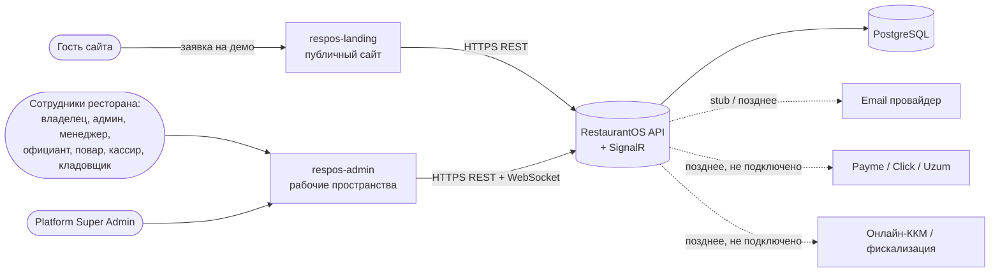
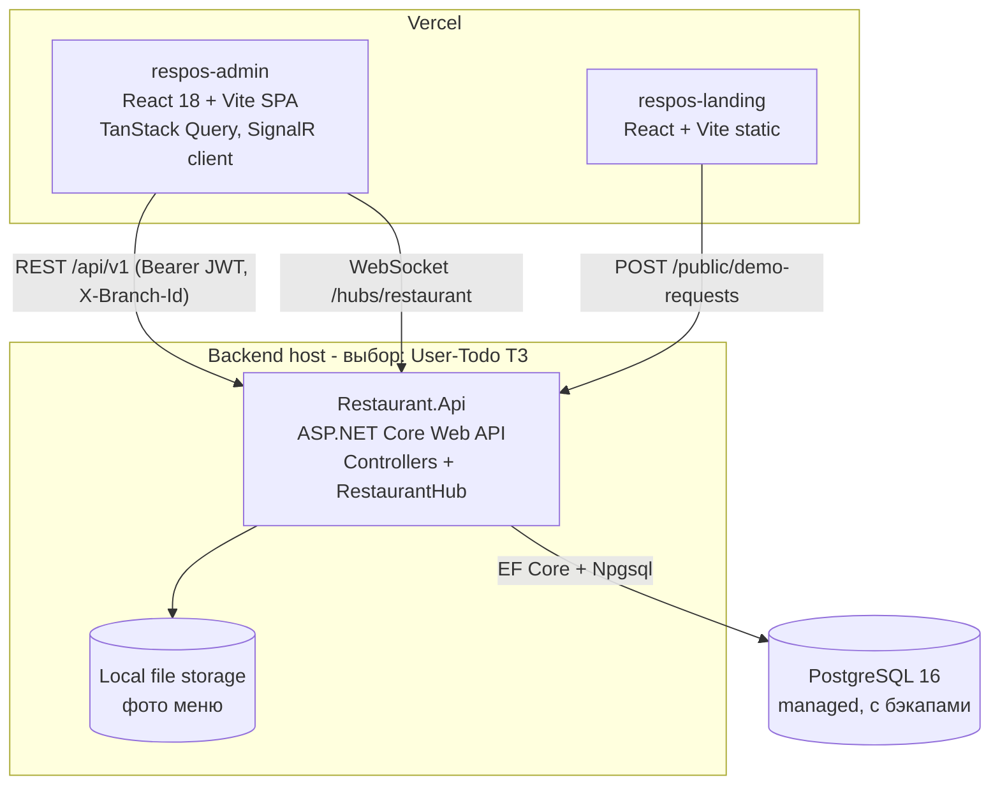
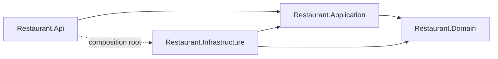
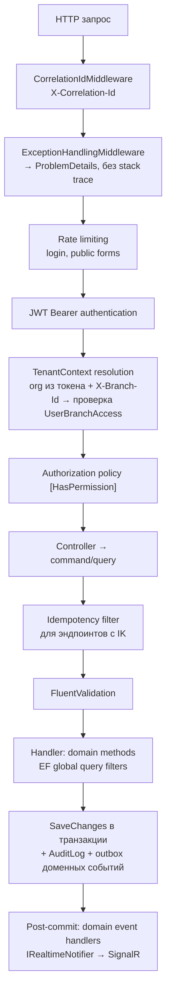
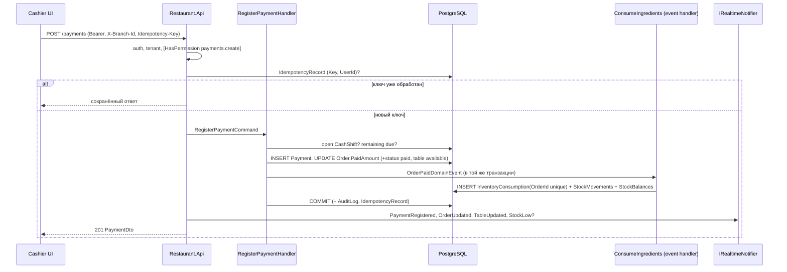

# RestaurantOS — обзор архитектуры

Связанные документы: контракт `respos-contracts/` (источник истины для API), ADR в `docs/architecture/ADR/`,
модель данных `docs/database/ERD.md`, бизнес-правила `docs/requirements/BUSINESS_RULES.md`.

## 1. Кратко

- **Модульный монолит** на .NET 8 (план перехода на .NET 10 LTS — ADR-0009), Clean Architecture (ADR-0001).
- Одна БД PostgreSQL, общая схема, tenant scoping через `OrganizationId` + `BranchId` (ADR-0002).
- Один React SPA `respos-admin` с рабочими пространствами (Admin, Waiter, KDS, Cashier, Stock, Platform) и отдельный статический `respos-landing` (ADR-0010).
- REST `/api/v1` — источник данных; SignalR `/hubs/restaurant` — только уведомления (ADR-0005).
- Auth: короткий JWT в памяти + ротируемый refresh token в httpOnly cookie (ADR-0003).

## 2. Контекст (C4 — уровень 1)

Пунктир — интеграции, которых в MVP нет (в UI помечаются «Демо» / «Не подключено»).

## 3. Контейнеры (C4 — уровень 2)

## 4. Слои backend

Решение: `respos-backend/` (в ТЗ — `backend/`).

| Проект | Содержит | Зависит от |
|---|---|---|
| `src/Restaurant.Domain` | Entities, Value Objects, Enums, доменные события, исключения, `Constants/Permissions.cs`, базовые `Entity`/`AuditableEntity`/`ITenantScoped`/`IBranchScoped`/`IArchivable`, `Result`/`Error` | ничего |
| `src/Restaurant.Application` | Use cases (commands/queries + handlers), DTO, validators (FluentValidation), абстракции: `IAppDbContext`, `ICurrentUser`, `ITenantContext`, `IClock`, `IFileStorage`, `IPaymentProvider`, `IRealtimeNotifier`, `IEmailSender` | Domain |
| `src/Restaurant.Infrastructure` | EF Core DbContext, configurations, migrations, seed, identity (hashing, JWT, refresh tokens), SignalR notifier, ManualPaymentProvider, файлы, логирование | Application, Domain |
| `src/Restaurant.Api` | Controllers, middleware, auth/policies, `RestaurantHub`, DI composition, Swagger, health checks | Application, Infrastructure (только composition root) |
| `tests/Restaurant.UnitTests` | Domain + Application unit tests | |
| `tests/Restaurant.IntegrationTests` | API + Postgres (Testcontainers) | |

Правила: `Api → Application → Domain`; Infrastructure реализует абстракции Application. Domain не ссылается
на ASP.NET Core, EF Core, SignalR. В контроллерах нет DbContext и бизнес-логики — только маппинг HTTP ↔ command/query.

## 5. Модули

Модули ТЗ §7.3 → папки `Restaurant.Application/Features/*` (одноимённые подпапки в Domain/Entities и Infrastructure/Persistence/Configurations).

| Модуль | Features-папка | Ключевые сущности | Права (префикс) |
|---|---|---|---|
| Identity | `Auth`, `Users`, `Roles` | User, Role, Permission, RefreshToken, UserInvitation | `users.*`, `roles.*` |
| Organization | `Organizations`, `Platform` | Organization, Plan, Subscription, FeatureFlag, DemoRequest | `settings.manage`, `platform.*` |
| Branches | `Branches` | RestaurantBranch, BranchSettings, UserBranchAccess | `branches.*` |
| Floor | `Tables` | DiningArea, DiningTable | `tables.*` |
| Reservations | `Reservations` | TableReservation | `reservations.*` |
| Menu | `Menu` | MenuCategory, MenuItem, Variant, ModifierGroup/Option, MenuAvailability | `menu.*` |
| Orders | `Orders` | Order, OrderItem, OrderItemModifier, OrderStatusHistory | `orders.*` |
| Kitchen | `Kitchen` | KitchenStation, KitchenTicket, KitchenTicketItem | `kitchen.*` |
| Inventory | `Inventory`, `Recipes` | Ingredient, StockBalance, StockMovement, Recipe, InventoryConsumption, InventoryCount | `inventory.*`, `recipes.*` |
| Procurement | `Suppliers`, `Purchases` | Supplier, PurchaseOrder, PurchaseOrderItem | `suppliers.*`, `purchases.*` |
| Payments | `Payments`, `CashShifts` | Payment, Refund, CashShift | `payments.*`, `cash-shifts.*` |
| Reporting | `Reports`, `Dashboard` | (read models, запросы) | `reports.read` |
| Notifications | `Notifications` | Notification, NotificationRead | `notifications.read` |
| Audit | `Audit` | AuditLog | `audit.read` |

### Правила границ модулей

1. Handler пишет только в сущности **своего** модуля. Изменения в другом модуле — через доменное событие
   (например, `OrderPaidDomainEvent` → Inventory списывает ингредиенты) или через явно объявленный
   application-сервис (например, `IStockService.ApplyMovement` — единственная точка изменения остатка).
2. Чтение чужих данных для отображения допустимо через DbContext (read-only проекции), без изменения.
3. Reporting только читает. Audit пишется через `IAuditLogger`, а не напрямую в таблицу.
4. Циклические зависимости между Features запрещены; общие вещи — в `Application/Common` и `Abstractions`.
5. Один DbContext на приложение (одна транзакция на команду); разделение БД по модулям — не в MVP.

## 6. Конвейер запроса

Детали:

- **Tenant context** (`ITenantContext`): `OrganizationId` берётся только из claim `org` токена; `BranchId` — только
  из заголовка `X-Branch-Id` после проверки доступа (owner/admin — все филиалы организации). Нет контекста на
  tenant-эндпоинте → 403 `tenant.branch_forbidden`. ID из тела запроса для scoping не используются.
- **Ошибки**: доменные исключения/`Result.Failure` маппятся в коды контракта (`order.invalid_status_transition` → 409,
  `validation.failed` → 400, чужой ID → 404). 500 отдаёт только `server.error` + `correlationId`.
- **Транзакции**: одна команда = одна транзакция. Остаток склада и `StockMovement` пишутся вместе (ADR-0006).
- **Конкурентность**: `Order`, `StockBalance` имеют `RowVersion` (`xmin`); конфликт → 409, клиент перечитывает.

### Пример: оплата заказа

Списание выполняется в той же транзакции, что и перевод заказа в `paid` (или надёжно после неё через outbox —
решает backend-агент; в любом случае идемпотентность гарантирует уникальный `InventoryConsumption.OrderId`).

## 7. Multi-tenancy

Подробно — ADR-0002.

- Все бизнес-таблицы: `OrganizationId` (индекс) + EF global query filter `e.OrganizationId == tenant.OrganizationId`.
- Филиальные таблицы: `BranchId`; в запросах явный фильтр `BranchId == tenant.BranchId`.
- При создании сущности `OrganizationId`/`BranchId` проставляются в `SaveChanges` interceptor-е из контекста, а не из DTO.
- Чужой ID → 404 (не раскрываем существование).
- Platform Super Admin работает без `org` в токене и видит только агрегаты; доступ к данным ресторана —
  только break-glass `POST /platform/organizations/{id}/access` с причиной, read-only, 30 мин, аудит.
- Изоляция проверяется интеграционными тестами (см. `docs/testing/TEST_PLAN.md`).

## 8. Realtime

Подробно — `respos-contracts/REALTIME.md`, ADR-0005.

- Hub `/hubs/restaurant`, JWT через `access_token` query. Группы: `branch:{id}`, `branch:{id}:kitchen`,
  `branch:{id}:station:{stationId}`, `user:{userId}`. `JoinBranch` проверяет доступ к филиалу.
- События отправляются **после commit**; payload минимальный (ID + статус).
- Клиент после события инвалидирует запросы TanStack Query и перечитывает REST; после reconnect — полная инвалидация
  запросов текущего workspace.
- Масштабирование: в MVP один инстанс API. При нескольких инстансах потребуется backplane (Redis) или Azure SignalR — отдельный ADR.

## 9. Идемпотентность

- Заголовок `Idempotency-Key` обязателен для `POST /payments`, `POST /payments/{id}/refunds`,
  `POST /orders/{id}/send-to-kitchen`, `POST /purchases/{id}/receive`.
- `IdempotencyRecord (Key, UserId)` unique; хранится хеш запроса и ответ 24 ч. Тот же ключ + другой body → 409/422.
- Дополнительные защиты на уровне данных: `Payment (OrganizationId, IdempotencyKey)` unique,
  `InventoryConsumption.OrderId` unique, проверка `amount ≤ remaining due`.

## 10. Аудит и логирование

- `AuditLog` append-only: пользователь, организация, филиал, action (`order.cancelled`, `payment.refunded`,
  `user.role_changed`, `stock.adjusted`, `platform.tenant_access` …), сущность, ID, correlationId, санитизированный `ChangesJson`.
- Не логировать пароли, токены, hash-и, платёжные секреты, лишние персональные данные.
- Serilog — структурированные логи в stdout (JSON в prod), обогащение `CorrelationId`, `OrganizationId`, `UserId`.
- Health checks: `/health/live` (процесс), `/health/ready` (БД).

## 11. Frontend (кратко)

`respos-admin/src` (в ТЗ — `frontend/`): `app/` (providers, router, layouts по workspace), `pages/`, `widgets/`,
`features/`, `entities/`, `shared/` (один `api-client`, один `permissions.ts`, `format-currency`, `realtime/`).
Access token хранится только в памяти; при загрузке страницы — `POST /auth/refresh`. Права в UI — только UX.

## 12. Развитие

Предусмотрено без переписывания: доставка (новый `OrderType`), платёжные провайдеры (`IPaymentProvider`),
фискализация (адаптер), SMS/Telegram (адаптеры уведомлений), несколько инстансов (SignalR backplane),
выделение модуля в сервис — только при доказанной необходимости.
