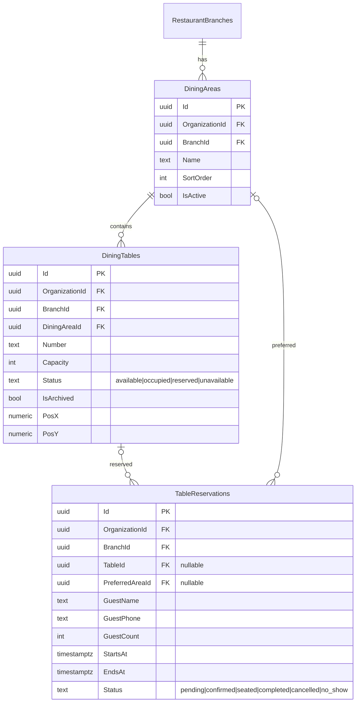
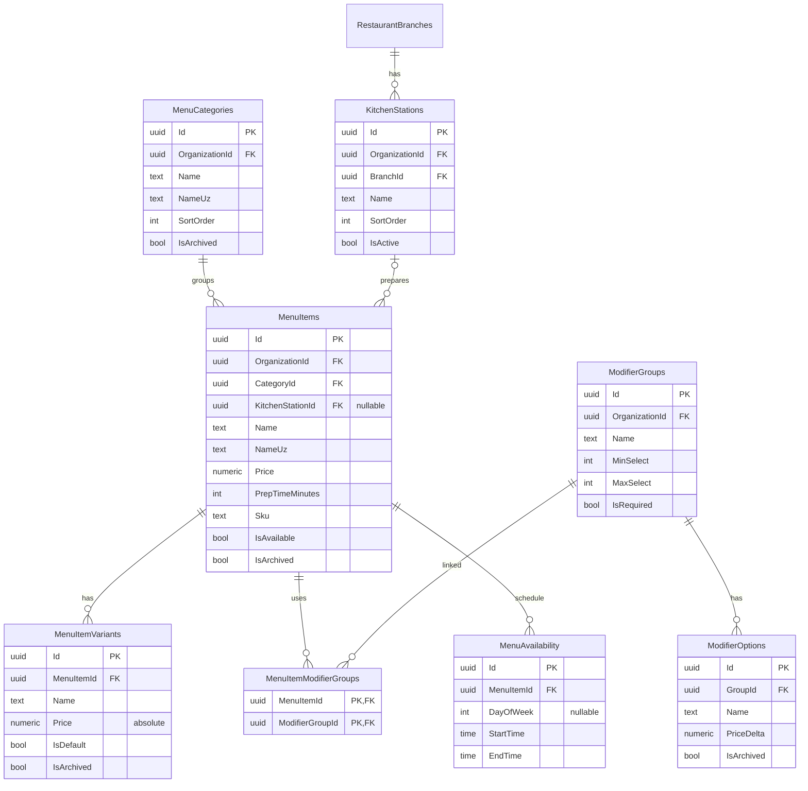
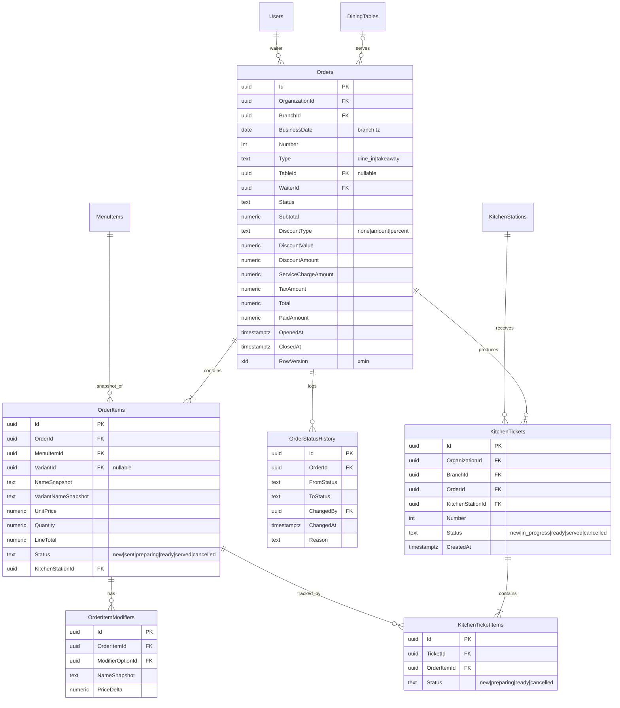

# RestaurantOS — ERD и модель данных

Источник истины по полям — `respos-contracts/DOMAIN_MODEL.md`. Здесь: связи, ключи, ограничения, индексы,
правила удаления и tenant scope. PostgreSQL 16, EF Core 8 (Npgsql). Имена таблиц — множественное число (`Orders`).

> Модель данных разделена на 3 файла: [ERD.md](ERD.md) (соглашения, Identity, Floor, Menu, Orders & Kitchen) ·
> [ERD_INVENTORY_PAYMENTS.md](ERD_INVENTORY_PAYMENTS.md) (Inventory, Procurement, Payments, Notifications/Audit) ·
> [ERD_CONSTRAINTS.md](ERD_CONSTRAINTS.md) (scope, уникальные ограничения, удаление, индексы, инварианты, вопросы).

## 0. Общие соглашения

| Что | Тип / правило |
|---|---|
| PK | `Id uuid` (генерируется приложением, `Guid.CreateVersion7()`/sequential — на выбор backend) |
| Деньги | `numeric(18,2)` |
| Количество | `numeric(18,3)` |
| Проценты | `numeric(5,2)` |
| Коэффициент конверсии | `numeric(18,6)` |
| Время | `timestamptz`, хранится UTC; date-only — `date` в timezone филиала |
| Enum | `text` со snake_case значением (как в API) + CHECK constraint |
| Concurrency | `RowVersion` = системная колонка `xmin` (Npgsql `UseXminAsConcurrencyToken`) — `Orders`, `StockBalances`, `CashShifts` |
| Аудит-поля | `CreatedAt, CreatedBy, UpdatedAt, UpdatedBy` (`AuditableEntity`) |
| Архив | `IsArchived bool, ArchivedAt timestamptz null` (`IArchivable`) |
| Tenant | `OrganizationId uuid not null` + индекс + EF global query filter; филиальные — ещё `BranchId uuid not null` |

**Удаление:** по умолчанию FK `ON DELETE RESTRICT`. `CASCADE` только для принадлежащих дочерних строк агрегата
(перечислены в [ERD_CONSTRAINTS.md §9](ERD_CONSTRAINTS.md)). Всё, на что ссылается история (меню, столы, ингредиенты, поставщики, пользователи, роли),
архивируется/деактивируется, а не удаляется. Физически удаляются только черновики без истории.

Обозначения scope: **G** — глобальная (без tenant), **O** — `OrganizationId`, **B** — `OrganizationId` + `BranchId`,
**C** — дочерняя строка, scope через родителя (собственный `OrganizationId` не обязателен, запросы — только через агрегат).

## 1. Identity / SaaS

```mermaid
erDiagram
  Organizations ||--o{ RestaurantBranches : has
  RestaurantBranches ||--|| BranchSettings : has
  Users ||--o{ UserOrganizations : member
  Organizations ||--o{ UserOrganizations : has
  Organizations ||--o{ Roles : defines
  Roles ||--o{ RolePermissions : grants
  Permissions ||--o{ RolePermissions : in
  Users ||--o{ UserRoles : has
  Roles ||--o{ UserRoles : assigned
  Users ||--o{ UserBranchAccess : can
  RestaurantBranches ||--o{ UserBranchAccess : allows
  Users ||--o{ RefreshTokens : owns
  Users ||--o{ PasswordResetTokens : requests
  Organizations ||--o{ UserInvitations : sends
  Plans ||--o{ PlanFeatures : includes
  Features ||--o{ PlanFeatures : in
  Plans ||--o{ Subscriptions : used_by
  Organizations ||--o{ Subscriptions : has
  Organizations |o--o{ FeatureFlags : overrides
  Organizations ||--o{ BillingEvents : has

  Organizations {
    uuid Id PK
    text Name
    text Slug UK
    text Currency "UZS"
    text DefaultLanguage "ru"
    text Status "active|suspended|closed"
    bool IsDemo
  }
  RestaurantBranches {
    uuid Id PK
    uuid OrganizationId FK
    text Name
    text Timezone "Asia/Tashkent"
    bool IsActive
  }
  BranchSettings {
    uuid BranchId PK,FK
    uuid OrganizationId FK
    numeric ServiceChargePercent
    numeric TaxPercent
    bool AllowNegativeStock
    text InventoryConsumptionTrigger "on_payment"
  }
  Users {
    uuid Id PK
    text Email UK "normalized lower"
    text PasswordHash
    text Status "active|invited|blocked|deactivated"
    bool IsPlatformAdmin
    int FailedLoginCount
    timestamptz LockoutUntil
  }
  UserOrganizations {
    uuid Id PK
    uuid UserId FK
    uuid OrganizationId FK
    bool IsActive
  }
  Roles {
    uuid Id PK
    uuid OrganizationId FK
    text Code
    bool IsSystem
  }
  Permissions {
    text Code PK
    text Module
  }
  RolePermissions {
    uuid RoleId PK,FK
    text PermissionCode PK,FK
  }
  UserRoles {
    uuid UserId PK,FK
    uuid RoleId PK,FK
    uuid OrganizationId FK
  }
  UserBranchAccess {
    uuid UserId PK,FK
    uuid BranchId PK,FK
    uuid OrganizationId FK
  }
  RefreshTokens {
    uuid Id PK
    uuid UserId FK
    uuid OrganizationId FK "nullable"
    text TokenHash UK "SHA-256"
    uuid FamilyId
    timestamptz ExpiresAt
    timestamptz RevokedAt
    uuid ReplacedByTokenId FK
  }
  UserInvitations {
    uuid Id PK
    uuid OrganizationId FK
    text Email
    jsonb RoleIds
    jsonb BranchIds
    text TokenHash UK
    timestamptz ExpiresAt
  }
  PasswordResetTokens {
    uuid Id PK
    uuid UserId FK
    text TokenHash UK
    timestamptz UsedAt
  }
  Plans {
    uuid Id PK
    text Code UK "starter|business|enterprise"
    int MaxBranches
    int MaxUsers
  }
  Features {
    uuid Id PK
    text Code UK
  }
  PlanFeatures {
    uuid PlanId PK,FK
    uuid FeatureId PK,FK
  }
  Subscriptions {
    uuid Id PK
    uuid OrganizationId FK
    uuid PlanId FK
    text Status
  }
  FeatureFlags {
    uuid Id PK
    uuid OrganizationId FK "null = global"
    text FeatureCode
    bool IsEnabled
  }
  BillingEvents {
    uuid Id PK
    uuid OrganizationId FK
  }
```

`DemoRequests` (G) — отдельная таблица без связей (заявки с лендинга).

## 2. Floor & Reservations

## 3. Menu & Kitchen stations

## 4. Orders & Kitchen

