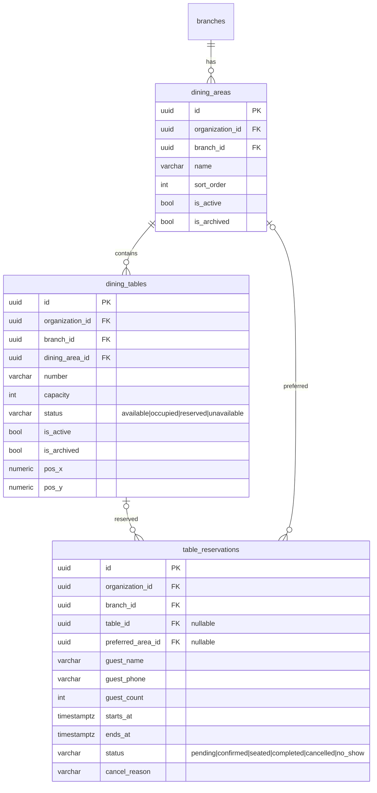
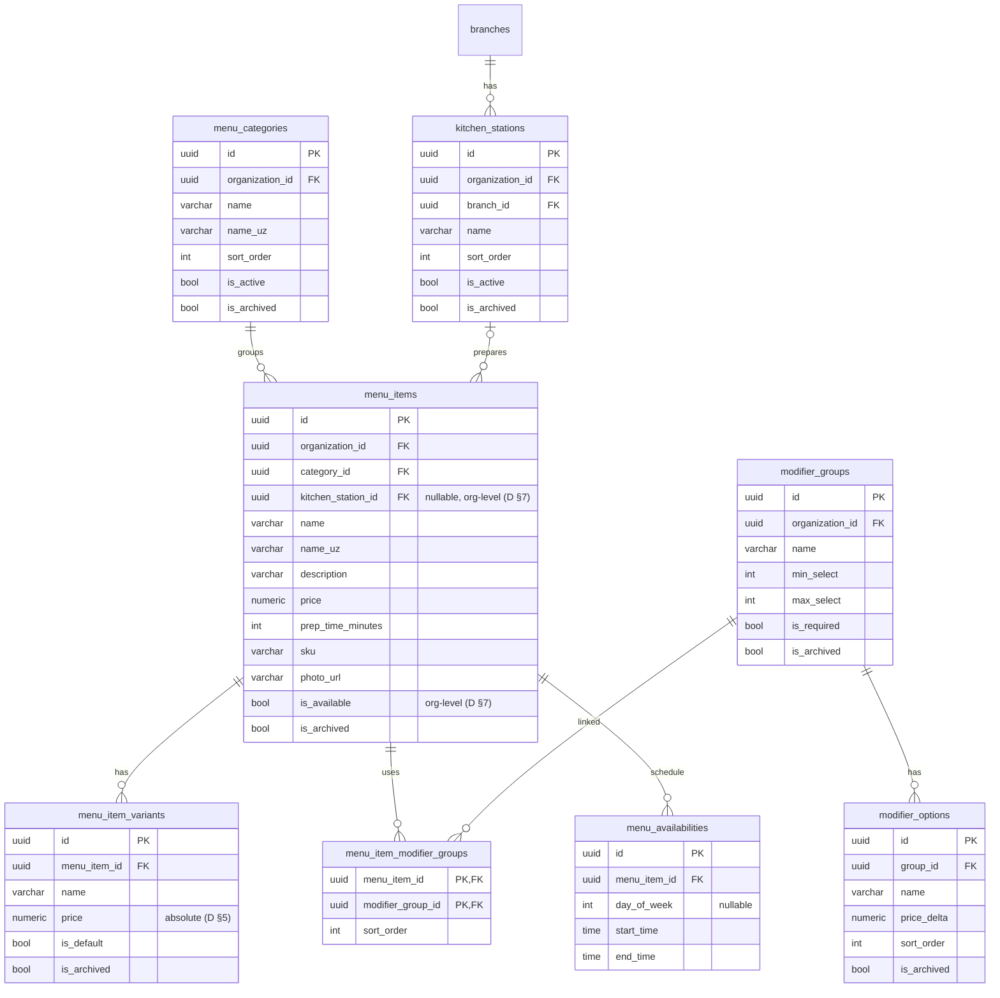
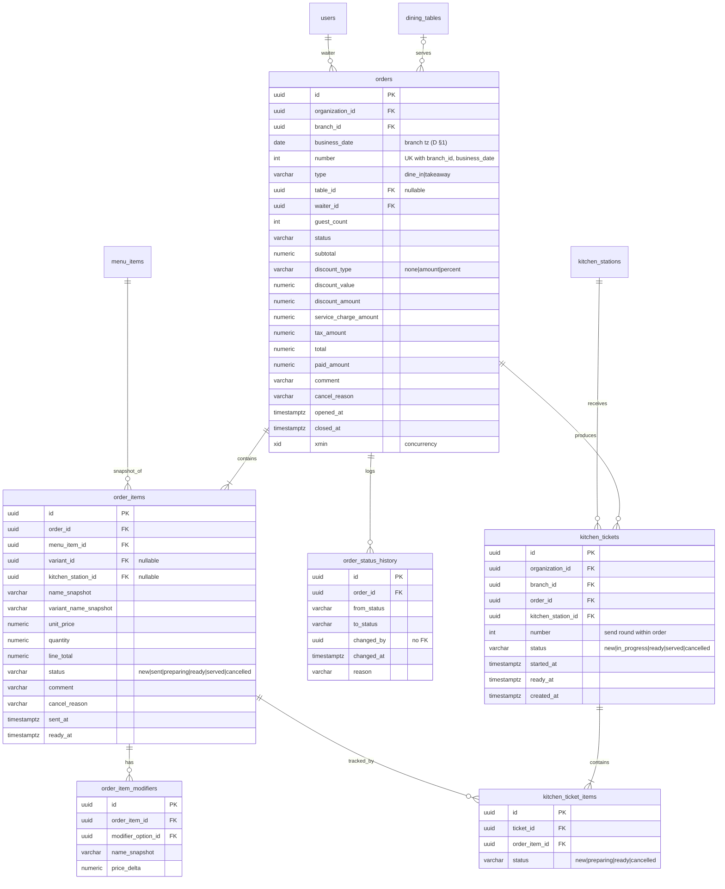

# RestaurantOS — ERD и модель данных

Сверено с реальной EF-моделью (`respos-backend/src/Restaurant.Infrastructure/Persistence/Migrations/AppDbContextModelSnapshot.cs`,
миграция `InitialCreate`) и конфигурациями `Persistence/Configurations/<Module>/`. Поля сущностей — `respos-contracts/DOMAIN_MODEL.md`
с уточнениями `respos-contracts/DECISIONS_v1_1.md`. PostgreSQL 16, EF Core 8 (Npgsql) + `UseSnakeCaseNamingConvention()`.

> Модель данных разделена на 3 файла: [ERD.md](ERD.md) (соглашения, Identity/SaaS, Floor, Menu, Orders & Kitchen) ·
> [ERD_INVENTORY_PAYMENTS.md](ERD_INVENTORY_PAYMENTS.md) (Inventory, Procurement, Payments, Notifications/Audit) ·
> [ERD_CONSTRAINTS.md](ERD_CONSTRAINTS.md) (scope, уникальные ограничения, удаление, индексы, инварианты, решённые вопросы).

## 0. Общие соглашения

| Что | Тип / правило |
|---|---|
| Имена | таблицы и колонки — `snake_case`, таблицы во множественном числе (`orders`, `order_items`, `branches`); C#-свойство `BranchId` ↔ колонка `branch_id` |
| PK | `id uuid` (генерируется приложением). Исключения: `permissions.code`, `features.code`; составные PK у связок (`role_permissions`, `user_roles`, …) |
| Деньги | `numeric(18,2)` (по умолчанию для всех `decimal`) |
| Количество | `numeric(18,3)` (`IsQuantity()`) |
| Проценты | `numeric(5,2)`; координаты столов `numeric(9,2)` |
| Коэффициент конверсии | `numeric(18,6)` |
| Время | `timestamptz` (UTC); `orders.business_date` — `date` в timezone филиала; `menu_availabilities.start_time/end_time` — `time` |
| Enum | `varchar(32)` со snake_case значением (как в API). CHECK constraints **не** создаются — значения контролирует код |
| Строки | `varchar(N)` с явной длиной (имена 200, коды 64, причины 500, комментарии 1000/2000) |
| Concurrency | системная колонка `xmin` (`xid`) — только `orders` и `stock_balances`; конфликт → `409 concurrency.conflict` |
| Аудит-поля | `created_at, created_by, updated_at, updated_by` (`AuditableEntity`, заполняет `AuditableEntityInterceptor`) |
| Архив | `is_archived bool, archived_at timestamptz null` (`IArchivable`); у части таблиц ещё `is_active` |
| Tenant | `organization_id uuid not null` + индекс + EF global query filter; филиальные — ещё `branch_id uuid not null` (фильтр явный в handler-ах) |
| История миграций | таблица `__ef_migrations_history` |

**Удаление:** по умолчанию FK `ON DELETE RESTRICT`. `CASCADE` — только для дочерних строк агрегата
(список — [ERD_CONSTRAINTS.md §9](ERD_CONSTRAINTS.md)). Всё, на что ссылается история, архивируется/деактивируется.

Обозначения scope: **G** — глобальная (без tenant), **O** — `organization_id`, **B** — `organization_id` + `branch_id`,
**C** — дочерняя строка без собственного `organization_id`, доступ только через корень агрегата (DECISIONS_v1_1 §6).

## 1. Identity / SaaS

```mermaid
erDiagram
  organizations ||--o{ branches : has
  branches ||--|| branch_settings : has
  users ||--o{ user_organizations : member
  organizations ||--o{ user_organizations : has
  organizations ||--o{ roles : defines
  roles ||--o{ role_permissions : grants
  permissions ||--o{ role_permissions : in
  users ||--o{ user_roles : has
  roles ||--o{ user_roles : assigned
  users ||--o{ user_branch_accesses : can
  branches ||--o{ user_branch_accesses : allows
  users ||--o{ refresh_tokens : owns
  users ||--o{ password_reset_tokens : requests
  organizations ||--o{ user_invitations : sends
  plans ||--o{ plan_features : includes
  features ||--o{ plan_features : in
  plans ||--o{ subscriptions : used_by
  organizations ||--o{ subscriptions : has
  organizations |o--o{ feature_flags : overrides
  organizations ||--o{ billing_events : has

  organizations {
    uuid id PK
    varchar name
    varchar slug UK
    varchar currency "UZS"
    varchar default_language "ru"
    varchar status "active|suspended|closed"
    bool is_demo
  }
  branches {
    uuid id PK
    uuid organization_id FK
    varchar name
    varchar address
    varchar phone
    varchar timezone "Asia/Tashkent"
    bool is_active
  }
  branch_settings {
    uuid id PK
    uuid branch_id FK,UK
    uuid organization_id FK
    numeric service_charge_percent
    numeric tax_percent
    bool allow_negative_stock
    varchar inventory_consumption_trigger "on_payment"
    varchar receipt_footer
  }
  users {
    uuid id PK
    varchar email UK "normalized lower"
    varchar password_hash "null для приглашённых"
    varchar full_name
    varchar status "active|invited|blocked|deactivated"
    bool is_platform_admin
    int failed_login_count
    timestamptz lockout_until
    timestamptz last_login_at
  }
  user_organizations {
    uuid id PK
    uuid user_id FK
    uuid organization_id FK
    bool is_active
    timestamptz joined_at
  }
  roles {
    uuid id PK
    uuid organization_id FK
    varchar code
    varchar name
    bool is_system
  }
  permissions {
    varchar code PK
    varchar module
  }
  role_permissions {
    uuid role_id PK,FK
    varchar permission_code PK,FK
  }
  user_roles {
    uuid user_id PK,FK
    uuid role_id PK,FK
    uuid organization_id FK
  }
  user_branch_accesses {
    uuid user_id PK,FK
    uuid branch_id PK,FK
    uuid organization_id FK
  }
  refresh_tokens {
    uuid id PK
    uuid user_id FK
    uuid organization_id FK "nullable"
    varchar token_hash UK "SHA-256"
    uuid family_id
    timestamptz expires_at
    timestamptz revoked_at
    uuid replaced_by_token_id
  }
  user_invitations {
    uuid id PK
    uuid organization_id FK
    uuid user_id FK "nullable"
    varchar email
    uuid_array role_ids "uuid[]"
    uuid_array branch_ids "uuid[]"
    varchar token_hash UK
    timestamptz expires_at
    timestamptz accepted_at
  }
  password_reset_tokens {
    uuid id PK
    uuid user_id FK
    varchar token_hash UK
    timestamptz expires_at
    timestamptz used_at
  }
  plans {
    uuid id PK
    varchar code UK "starter|business|enterprise"
    int max_branches
    int max_users
    bool is_active
  }
  features {
    varchar code PK
    varchar name
  }
  plan_features {
    uuid plan_id PK,FK
    varchar feature_code PK,FK
  }
  subscriptions {
    uuid id PK
    uuid organization_id FK
    uuid plan_id FK
    varchar status
    timestamptz starts_at
    timestamptz ends_at
  }
  feature_flags {
    uuid id PK
    uuid organization_id FK "null = global"
    varchar feature_code
    bool is_enabled
  }
  billing_events {
    uuid id PK
    uuid organization_id FK
    varchar type
    numeric amount
    jsonb payload_json
  }
```

`demo_requests` (G) — отдельная таблица без связей (заявки с лендинга, индекс `(status, created_at)`).

## 2. Floor & Reservations

## 3. Menu & Kitchen stations

## 4. Orders & Kitchen

Дочерние таблицы `order_items`, `order_item_modifiers`, `order_status_history`, `kitchen_ticket_items`, `menu_item_variants`,
`modifier_options`, `menu_item_modifier_groups`, `menu_availabilities`, `role_permissions`, `plan_features` не имеют `organization_id`
(scope **C**, DECISIONS_v1_1 §6).
