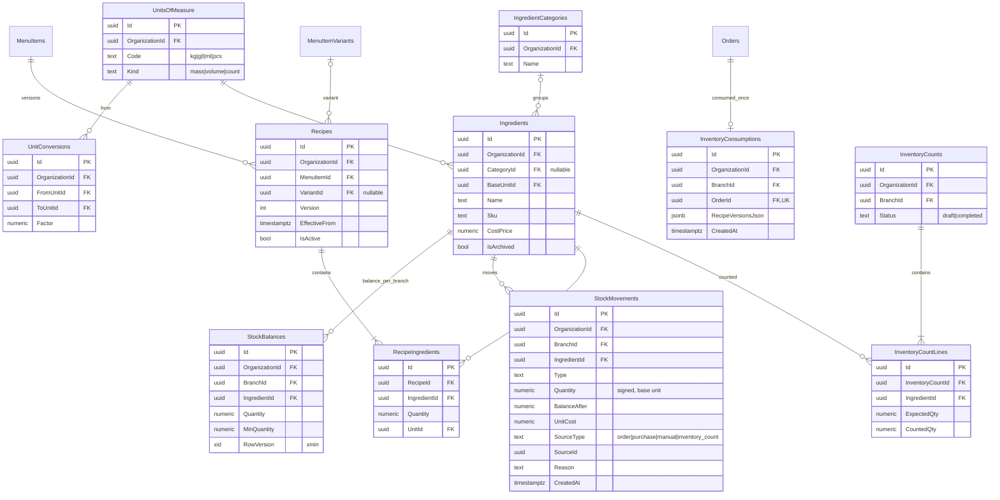
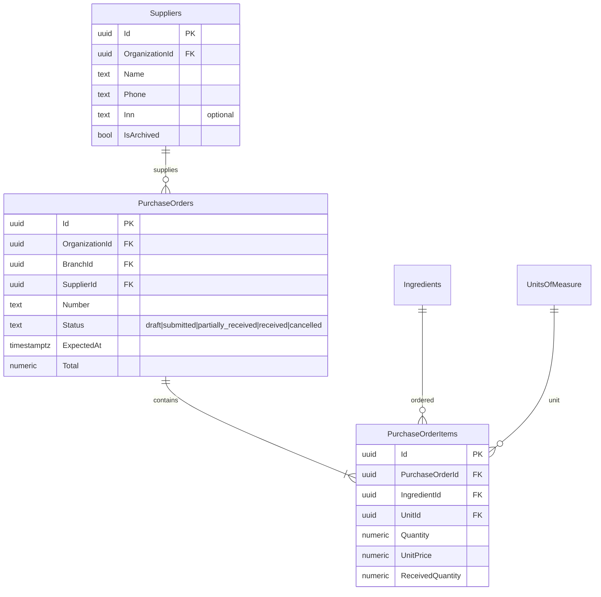
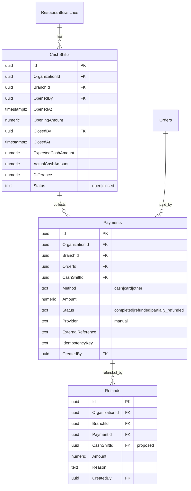
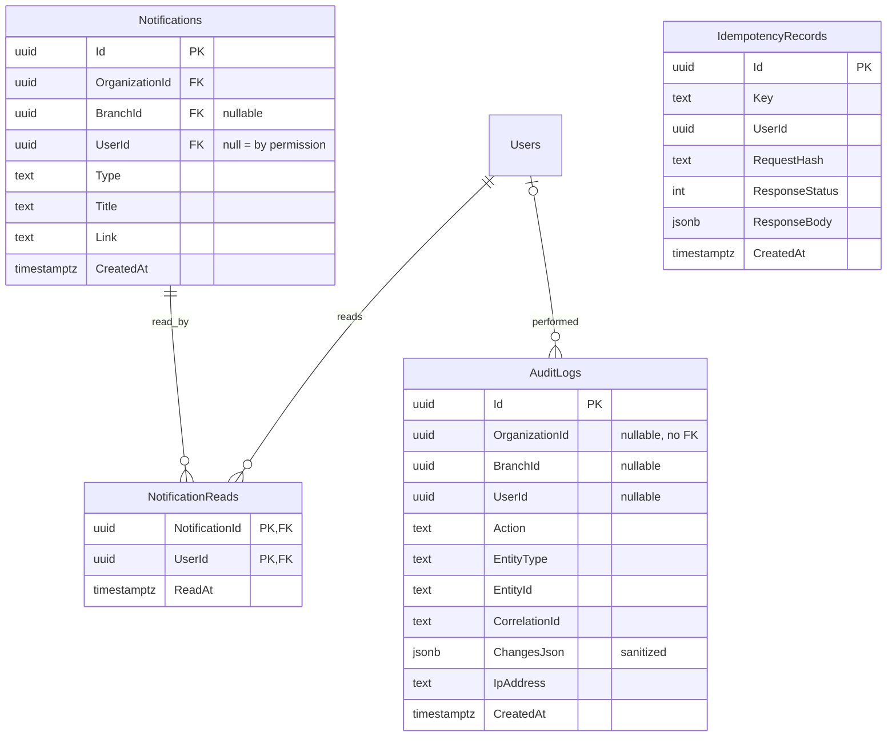

# RestaurantOS — ERD (часть 2): Inventory, Procurement, Payments, Audit

Соглашения по типам, scope (G/O/B/C) и удалению — см. [ERD.md §0](ERD.md#0-общие-соглашения).

> Модель данных разделена на 3 файла: [ERD.md](ERD.md) (соглашения, Identity, Floor, Menu, Orders & Kitchen) ·
> [ERD_INVENTORY_PAYMENTS.md](ERD_INVENTORY_PAYMENTS.md) (Inventory, Procurement, Payments, Notifications/Audit) ·
> [ERD_CONSTRAINTS.md](ERD_CONSTRAINTS.md) (scope, уникальные ограничения, удаление, индексы, инварианты, вопросы).

## 5. Inventory & Recipes

## 6. Procurement

Поступление создаёт `StockMovements` (`type = receipt`, `SourceType = purchase`, `SourceId = PurchaseOrderId`).

## 7. Payments & Cash

## 8. Notifications, Audit, Idempotency

`AuditLogs` — append-only (нет UPDATE/DELETE в коде; в prod можно отозвать права UPDATE/DELETE у роли приложения).
FK на пользователей/организации не ставятся, чтобы журнал переживал любые изменения справочников.

