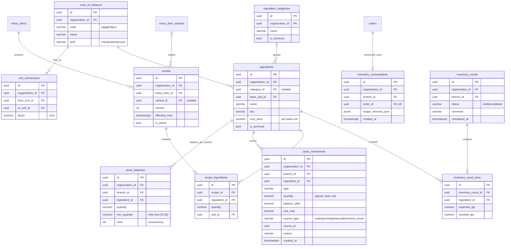
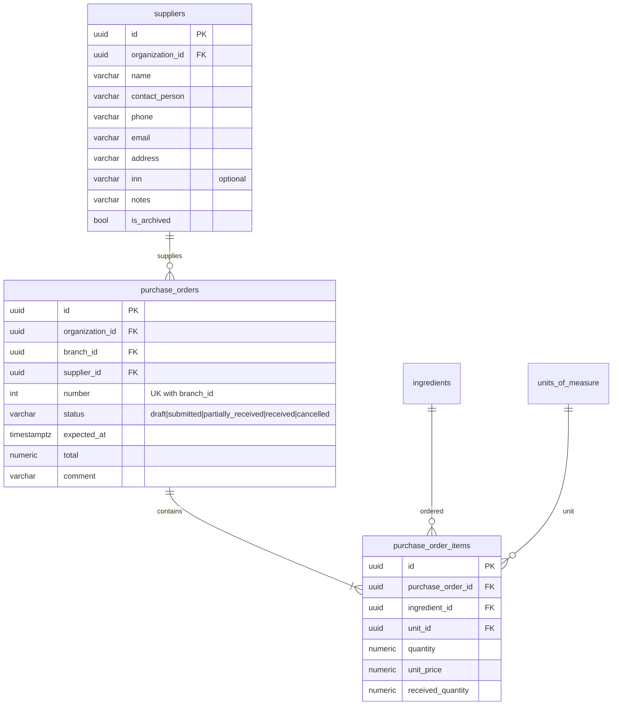
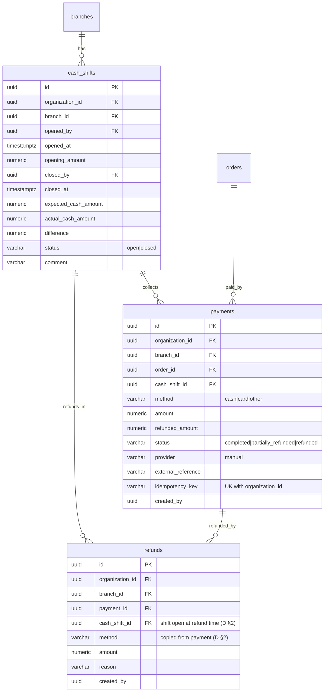
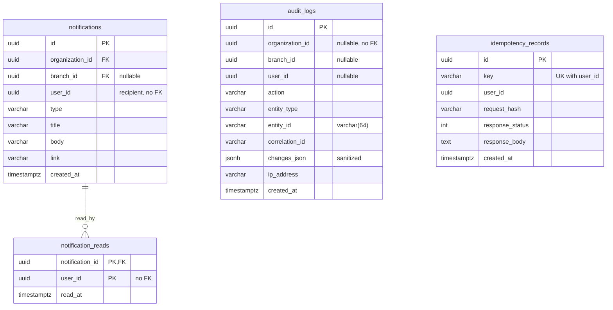

# RestaurantOS — ERD (часть 2): Inventory, Procurement, Payments, Audit

Соглашения по именам (snake_case), типам, scope (G/O/B/C) и удалению — см. [ERD.md §0](ERD.md#0-общие-соглашения).
Сверено с `AppDbContextModelSnapshot.cs`.

> Модель данных разделена на 3 файла: [ERD.md](ERD.md) (соглашения, Identity/SaaS, Floor, Menu, Orders & Kitchen) ·
> [ERD_INVENTORY_PAYMENTS.md](ERD_INVENTORY_PAYMENTS.md) (Inventory, Procurement, Payments, Notifications/Audit) ·
> [ERD_CONSTRAINTS.md](ERD_CONSTRAINTS.md) (scope, уникальные ограничения, удаление, индексы, инварианты, решённые вопросы).

## 5. Inventory & Recipes

## 6. Procurement

Поступление создаёт `stock_movements` (`type = receipt`, `source_type = purchase`, `source_id = purchase_order_id`).

## 7. Payments & Cash

`paidAmount = Σ payments.amount − Σ refunds.amount` (статус платежа информационный); ожидаемая наличность смены =
`opening_amount + Σ cash payments смены − Σ cash refunds смены` (по `refunds.cash_shift_id`).

## 8. Notifications, Audit, Idempotency

Уведомления — одна строка на получателя (`user_id`), без «рассылки по праву» в БД. `audit_logs` — append-only
(нет UPDATE/DELETE в коде); FK на пользователей/организации нет, чтобы журнал переживал изменения справочников.
