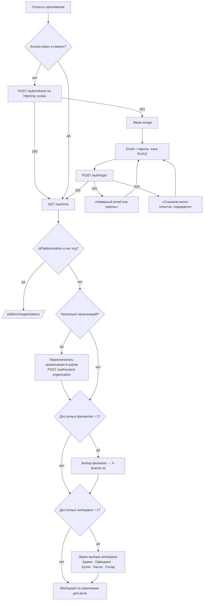
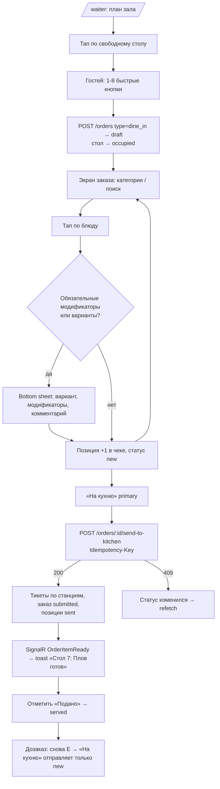
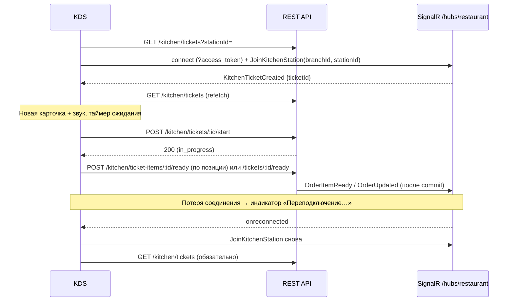
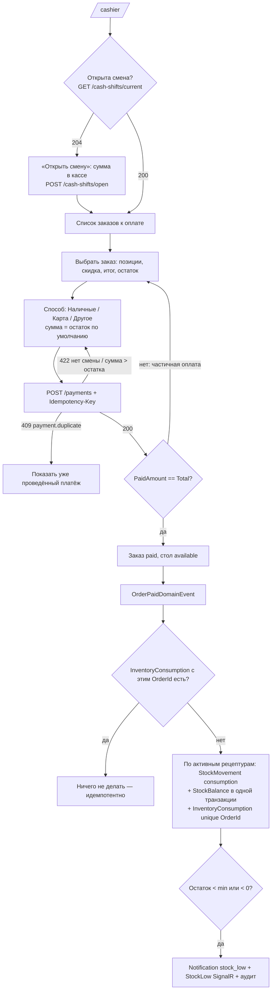
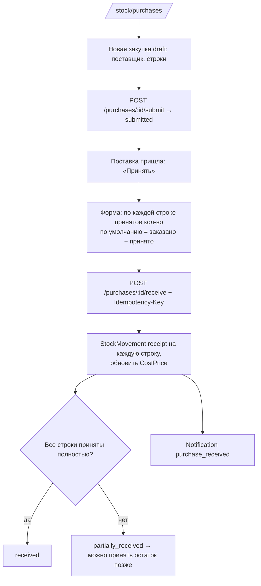
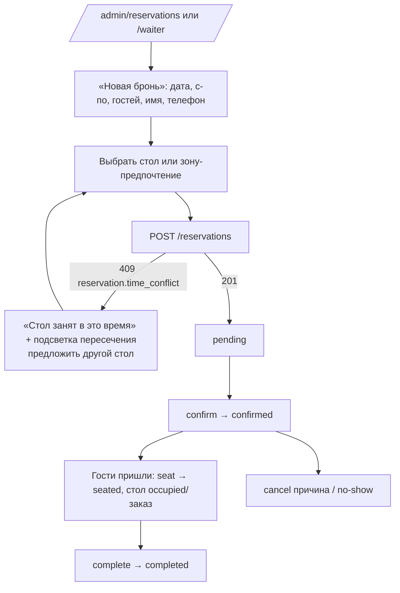
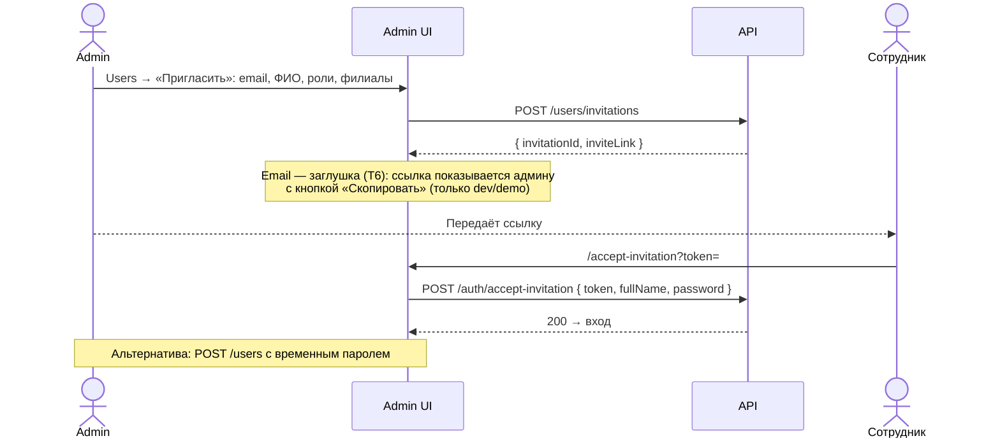
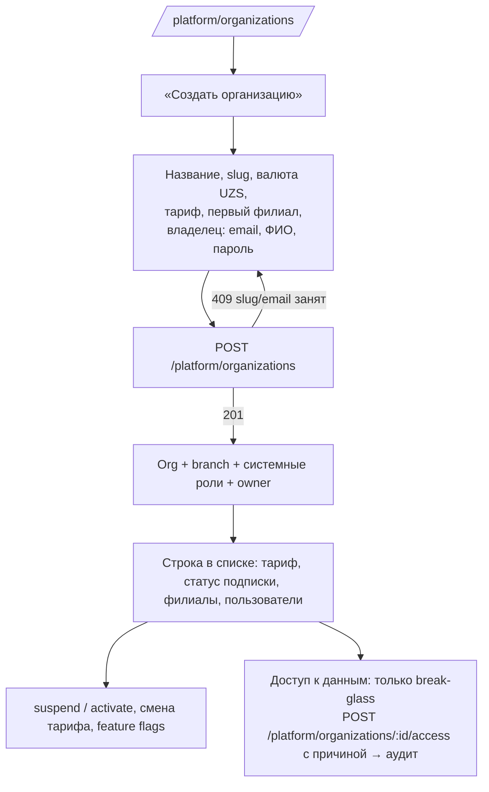

# User Flows

Сценарии согласованы с `respos-contracts/` (ENDPOINTS, REALTIME, CONVENTIONS). Эндпоинты указаны относительно `/api/v1`.

## 1. Вход и выбор рабочего пространства

Доступность workspace вычисляется по `permissions` из `MeDto`: Admin — `reports.read` или `settings.manage`,
Waiter — `orders.create`, KDS — `kitchen.read`, Cashier — `payments.create`, Stock — `inventory.read`.
Последний выбор workspace и филиала можно запомнить в `localStorage` (не секрет); токены — никогда.

## 2. Официант: заказ

Открытый стол (occupied) открывает текущий заказ (`activeOrderId` из `TableDto`). Отмена отправленной
позиции требует `orders.cancel` и причину.

## 3. Кухня (KDS)

Ошибочно отмеченное готовым — `POST /kitchen/tickets/:id/recall` (ready → in_progress).

## 4. Оплата и списание ингредиентов

Сдача для наличных считается на клиенте только для информации (переплата в MVP запрещена).
Возврат: `POST /payments/:id/refunds` (право `payments.refund`, причина обязательна, ConfirmDialog).
Повторное списание при возврате/повторной оплате не выполняется (Q7).

## 5. Приёмка закупки

## 6. Бронирование

Пересечение проверяется на сервере для активных статусов `pending|confirmed|seated` по `[StartsAt, EndsAt)`.

## 7. Приглашение сотрудника

## 8. Super Admin: создание организации

Super Admin видит только агрегаты организаций, не бизнес-данные.
